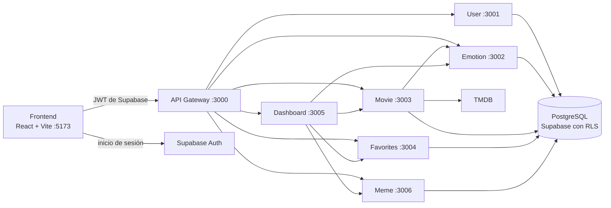

# Butaca 🎬

Butaca recomienda películas y series según cómo se siente el usuario. La emoción se detecta con la cámara o se elige a mano, y a partir de ella la aplicación sugiere títulos de TMDB, permite guardar favoritos, muestra memes para levantar el ánimo y resume todo en un tablero.

Proyecto final del curso Programación Web, Universidad Rafael Landívar.

## Arquitectura

El frontend solo habla con el API Gateway. El Gateway valida el token de Supabase y reenvía cada petición al microservicio que corresponde. Cada servicio vuelve a validar el token y consulta la base de datos con el usuario del token, de modo que las políticas RLS de PostgreSQL impiden ver datos de otra persona.



| Parte | Carpeta | Puerto | Qué hace |
|---|---|---|---|
| Frontend | `apps/web` | 5173 | Interfaz, inicio de sesión con Google o GitHub y detección de emociones con la cámara |
| API Gateway | `services/api-gateway` | 3000 | Punto de entrada único: autenticación, rate limit, trazabilidad y enrutamiento |
| User Service | `services/user-service` | 3001 | Perfil del usuario |
| Emotion Service | `services/emotion-service` | 3002 | Registro e historial de emociones |
| Movie Service | `services/movie-service` | 3003 | Recomendaciones y detalles desde TMDB |
| Favorites Service | `services/favorites-service` | 3004 | Películas y series guardadas |
| Dashboard Service | `services/dashboard-service` | 3005 | Resumen que combina los demás servicios |
| Meme Service | `services/meme-service` | 3006 | Catálogo de memes por emoción e historial |

Los paquetes compartidos están en `packages/`: `auth` valida los tokens, `database` tiene el cliente de Prisma y el contexto de usuario para RLS, y `shared` tiene constantes comunes.

## Requisitos

- Node.js 22.18 o superior (se recomienda 24).
- pnpm 10.
- Acceso al proyecto de Supabase y una API key de TMDB.
- Docker Desktop, solo si se quiere levantar todo con Docker.

## Instalación

```bash
pnpm install
```

Después hay que crear los archivos `.env`. Cada servicio, el frontend y el paquete de base de datos tienen un `.env.example` con las variables que necesitan; basta con copiarlo como `.env` en la misma carpeta y completar los valores.

| Archivo | Variables principales |
|---|---|
| `apps/web/.env` | `VITE_API_URL`, `VITE_SUPABASE_URL`, `VITE_SUPABASE_ANON_KEY` |
| `services/api-gateway/.env` | `SUPABASE_URL`, `WEB_URL` y las URL de los servicios |
| `services/user-service/.env`, `emotion-service`, `favorites-service`, `meme-service` | `DATABASE_URL`, `SUPABASE_URL` |
| `services/movie-service/.env` | `DATABASE_URL`, `SUPABASE_URL`, `TMDB_API_KEY`, `RECOMMENDATIONS_CURSOR_SECRET` |
| `services/dashboard-service/.env` | `SUPABASE_URL` y las URL de los servicios que consulta |
| `packages/database/.env` | `DIRECT_URL` para migraciones y las variables `RLS_TEST_*` para las pruebas de RLS |

`DATABASE_URL` debe usar el rol `butaca_app`, que no puede saltarse RLS. Nunca se usa el rol `postgres` ni la `service_role` key en los servicios. Los archivos `.env` están en `.gitignore` y no se suben al repositorio.

## Cómo ejecutarlo

### En desarrollo

```bash
pnpm dev            # frontend y los 7 servicios
pnpm dev:services   # solo Gateway y servicios
pnpm dev:web        # solo el frontend
```

El frontend queda en http://localhost:5173 y el Gateway en http://localhost:3000. Cada servicio responde `GET /health`, también a través del Gateway (por ejemplo `/api/movies/health`).

### Con Docker

```bash
docker compose -f infrastructure/docker/docker-compose.yml up --build
```

Levanta el frontend, el Gateway y los 6 servicios con los mismos `.env` de desarrollo. Solo quedan expuestos el frontend (5173) y el Gateway (3000); los demás servicios solo son accesibles dentro de la red de Docker. Para apagarlo:

```bash
docker compose -f infrastructure/docker/docker-compose.yml down
```

## Pruebas

```bash
pnpm test
```

Ejecuta las pruebas unitarias y de integración de todos los servicios, los paquetes y el cliente del frontend. No necesitan conexión a la base de datos; las que sí la necesitan se omiten si faltan sus variables.

Las pruebas de RLS se conectan a Supabase con dos usuarios de prueba y comprueban que ninguno puede leer ni modificar datos del otro. Requieren `packages/database/.env` completo:

```bash
pnpm --filter @butaca/database test:integration
```

Para probar la API completa a través del Gateway, con los servicios levantados, hay una colección de Postman en `docs/postman/Butaca.postman_collection.json`. También se puede ejecutar desde PowerShell sin abrir Postman:

```powershell
powershell -ExecutionPolicy Bypass -File docs\postman\probar-api.ps1 -Email <correo> -Password <contraseña>
```

GitHub Actions ejecuta `pnpm test` y compila el frontend en cada push (`.github/workflows/ci.yml`).

## Seguridad

- El Gateway exige un JWT válido de Supabase con rol `authenticated` en todas las rutas `/api/*`, y los servicios lo vuelven a validar.
- El id del usuario siempre sale del token, nunca de la ruta ni del cuerpo de la petición.
- La base de datos aplica RLS con el contexto del usuario en cada transacción (`withUserContext`).
- Los datos de entrada se validan con Zod y los errores siguen un formato común que no expone detalles internos.
- El Gateway aplica rate limit, cabeceras de seguridad con Helmet, CORS restringido al frontend y un `X-Request-Id` para seguir cada petición.

## Documentación

- [Contrato de la API](docs/api-contracts.md): rutas, formatos de respuesta y errores.
- [Base de datos y RLS](docs/database.md): rol `butaca_app`, contexto de usuario y pruebas de aislamiento.
- [API Gateway](services/api-gateway/README.md), [Emotion Service](services/emotion-service/README.md) y [Movie Service](services/movie-service/README.md).
